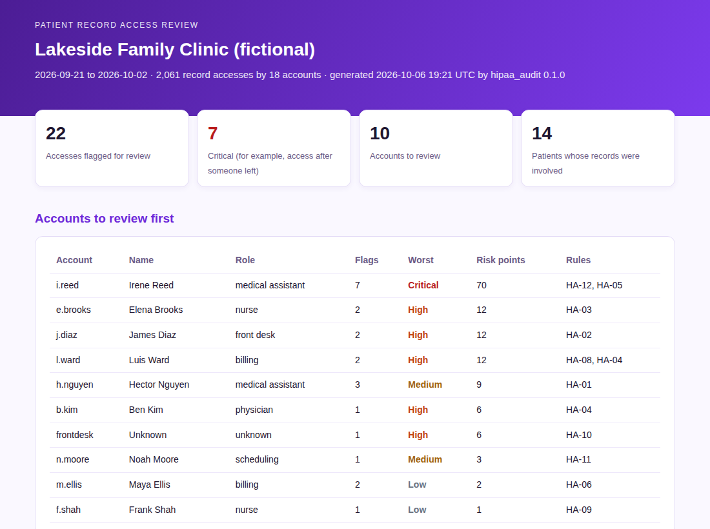

# HIPAA Audit Engine

[](https://github.com/Edward-Owusu/hipaa-audit-engine/actions/workflows/tests.yml)
[](LICENSE)

An open-source tool that helps **small healthcare providers** review who is accessing patient records. It reads electronic health record (EHR) access logs and flags the activity that most deserves a closer look, such as staff opening records of coworkers or family members, accounts used after someone left, bulk exports, and shared logins, and lays it out on a **timeline** for follow-up. Every flag maps to the **HIPAA Security Rule** and **NIST SP 800-53 Rev. 5**.



## Why this matters

Patient records are among the most sensitive information an organization holds, and some of the most damaging privacy incidents in healthcare come from inside: employees looking up a neighbor, a celebrity, an ex-partner, or a coworker; accounts that stay active after someone leaves; or a single login shared across the front desk.

The HIPAA Security Rule requires covered entities to record activity in systems containing electronic protected health information (45 CFR 164.312(b)) and to regularly review it (45 CFR 164.308(a)(1)(ii)(D)). Large hospitals buy dedicated privacy monitoring software for this. Small clinics, dental and physical therapy practices, and rural providers usually cannot. They have the logs but no practical way to review thousands of entries, so the review often does not happen.

This tool gives them that capability for free. It turns a raw access log into a short, prioritized list of accounts and events to check, with guidance on how to review each one. That helps small providers protect patients' privacy, meet their HIPAA obligations, and catch problems early, which matters for the many communities that depend on small and rural providers for care.

## What it does

- Applies **12 rules** to EHR access logs, workforce rosters, and patient rosters:
  - access with no treatment relationship
  - access to a family member's, coworker's, or high-profile patient's record
  - access by accounts after termination, and terminated accounts still active
  - after-hours access by office roles
  - bulk viewing, printing, or exporting
  - emergency break-the-glass access needing documentation
  - shared, generic, or unknown accounts
  - repeated failed sign-ins
- Draws a **timeline of flagged access**, day by day, with severity, the people and patient involved, and the regulation citation.
- **Ranks accounts** by risk so reviewers know where to start.
- Gives **review guidance** for each type of flag.
- Maps every flag to **HIPAA Security Rule** standards (45 CFR 164.308, 164.312), the Privacy Rule minimum necessary standard (164.502(b)), and **NIST SP 800-53 Rev. 5** controls (AU-6, AC-2, AC-6, PS-4, IA-2, AC-7, and others).
- Uses adjustable thresholds and role groups.
- Produces reports in **HTML, Markdown, CSV, and JSON**, with a command-line tool and an interactive **Streamlit dashboard**.
- Runs entirely **offline**, with **no third-party dependencies** in its core engine, so patient data never leaves the organization.

## Quick start

Requires Python 3.10 or later.

```bash
git clone https://github.com/Edward-Owusu/hipaa-audit-engine.git
cd hipaa-audit-engine
pip install -e .

hipaa-audit samples/lakeside_family_clinic_access_log.csv \
  --workforce samples/lakeside_family_clinic_workforce.csv \
  --patients samples/lakeside_family_clinic_patients.csv \
  --org "Lakeside Family Clinic" --format html md
```

Example output:

```
Lakeside Family Clinic | 2026-09-21 to 2026-10-02 | 2061 record accesses by 18 accounts
Flags: 22 (critical 7, high 8, medium 4, low 3) | accounts to review 10
  critical  i.reed       medical_assistant  7 flag(s): HA-12, HA-05
  high      e.brooks     nurse              2 flag(s): HA-03
  high      j.diaz       front_desk         2 flag(s): HA-02
  high      l.ward       billing            2 flag(s): HA-08, HA-04
  medium    h.nguyen     medical_assistant  3 flag(s): HA-01
```

Open the HTML file in the `reports` folder for the timeline. Pre-generated reports are in [docs/example-reports](docs/example-reports).

### Dashboard

```bash
pip install -r requirements.txt
streamlit run app/streamlit_app.py
```

**Never upload real patient data to a public demo.** Run the tool on your own computer or server to review real logs.

### Use in automation

`--fail-on <severity>` exits with code 2 when a flag at or above that severity exists, so a scheduled job can alert the privacy officer:

```bash
hipaa-audit access_log.csv --workforce workforce.csv --patients patients.csv --fail-on high
```

## Reviewing your own logs

1. Export a period of access logs from your EHR or practice management system, plus a workforce roster and a patient roster, in the format described in the [input reference](docs/data-reference.md).
2. Run the tool locally and work through the accounts at the top of the list, using the review guidance for each flag.
3. Document each review and its outcome, as your HIPAA policies require.

## Related projects

Part of a series of open-source GRC tools for small and mid-sized organizations:

- [NIST SP 800-53 Assessment Tool](https://github.com/Edward-Owusu/Nist-800-53-assessment-tool)
- [Zero Trust IAM Auditor](https://github.com/Edward-Owusu/Zero-trust-iam-auditor)
- [MFA Compliance Tracker](https://github.com/Edward-Owusu/mfa-compliance-tracker)
- [FedRAMP Cloud Analyzer](https://github.com/Edward-Owusu/fedramp-cloud-analyzer)
- [CMMC Readiness Toolkit](https://github.com/Edward-Owusu/cmmc-readiness-toolkit)
- [Vendor Risk Dashboard](https://github.com/Edward-Owusu/vendor-risk-dashboard)
- [Ransomware Resilience Framework](https://github.com/Edward-Owusu/ransomware-resilience-framework)

## Data and limitations

All sample data is synthetic and does not describe any real organization, employee, or patient. A flag is a prompt for review, not a finding of wrongdoing; many flagged accesses have legitimate explanations. This tool supports, and does not replace, a HIPAA risk analysis, privacy and security policies, or legal counsel, and it does not determine whether a breach occurred. See the [methodology](docs/methodology.md).

## References

- HIPAA Security Rule, 45 CFR Part 164, Subpart C; HHS guidance: https://www.hhs.gov/hipaa/for-professionals/security/index.html
- NIST SP 800-66 Rev. 2, *Implementing the Health Insurance Portability and Accountability Act (HIPAA) Security Rule: A Cybersecurity Resource Guide*: https://csrc.nist.gov/pubs/sp/800/66/r2/final
- NIST SP 800-53 Rev. 5, *Security and Privacy Controls for Information Systems and Organizations*: https://csrc.nist.gov/pubs/sp/800/53/r5/upd1/final

## Author

**Edward Owusu, CISA**, GRC Analyst and IT Auditor.

Feedback, issues, and contributions are welcome. If you use this tool in your practice, I would be glad to hear how it worked for you; please open an issue or get in touch.

## Citation

If you use this tool in research or professional work, please cite it using the metadata in [CITATION.cff](CITATION.cff).

## License

[MIT](LICENSE)
